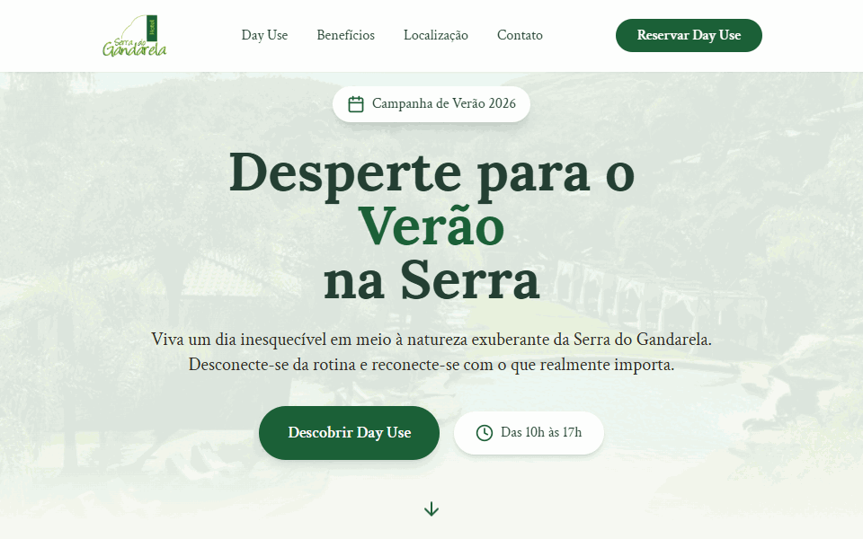
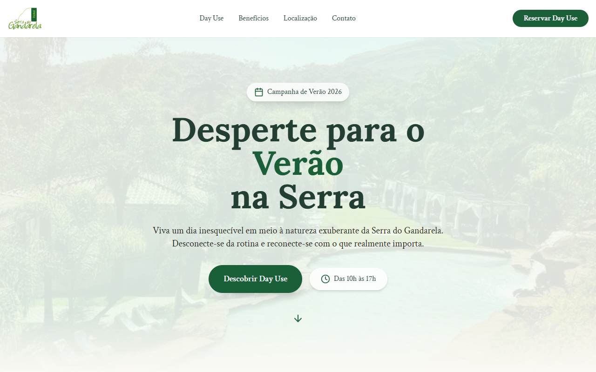
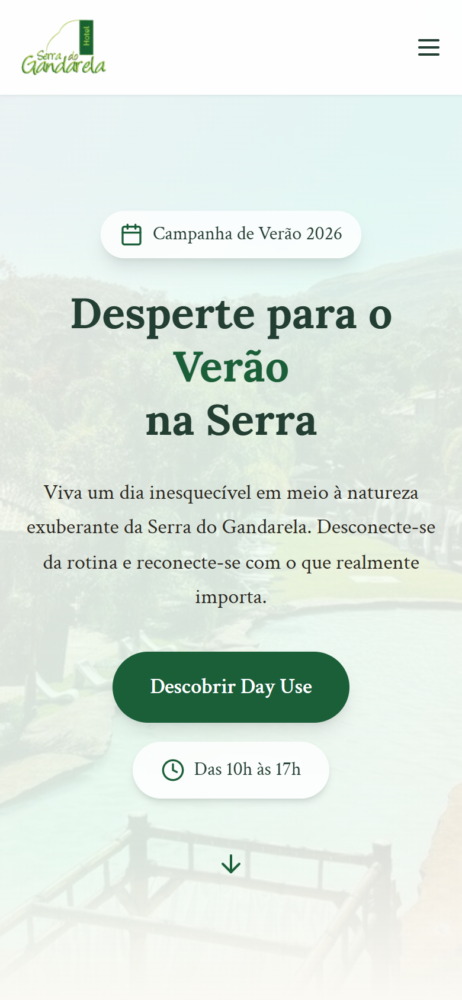

# Verão Day Use · Hotel Serra do Gandarela

**Landing page em produção** para a campanha de verão do Day Use do Hotel Serra do Gandarela, em Rio Acima (MG).

**[Ver a página no ar](https://hotelserradogandarela.com.br/verao-day-use/)**



## O problema

O hotel vendia o Day Use (passar o dia usando piscinas, áreas verdes e restaurante, sem dormir lá), mas muita gente chegava achando que tinha pernoite. As informações ficavam espalhadas entre posts e conversas de WhatsApp, e a equipe respondia as mesmas dúvidas várias vezes.

## A solução

Uma página única para onde os anúncios levam, montada para tirar a dúvida antes da reserva:

- **Destaque de verão** com o horário (10h às 17h) logo no topo.
- **O que é o Day Use**, deixando claro que não inclui hospedagem.
- **O que está incluído** e os benefícios do hotel: natureza, lazer e cozinha mineira.
- **Depoimentos e localização**, para quem vem de Belo Horizonte e região.
- **Botão de reserva fixo** no celular, sempre a um toque.

O caminho ficou mais curto: anúncio, página, reserva.

<p align="center">
  
  &nbsp;
  
</p>

## Como foi feito

- React + TypeScript com Vite, estilizado em Tailwind CSS e com ícones do lucide-react.
- Componentes separados por seção em `src/components` (Hero, Day Use, benefícios, depoimentos, localização, CTA).
- Publicada na hospedagem do próprio hotel (Hostinger), no caminho `/verao-day-use/`.

## Rodar no computador

```bash
npm install
npm run dev      # http://localhost:5173
npm run build    # gera a pasta dist/ para publicar
```

## Créditos

- **Cliente:** Hotel Serra do Gandarela, Rio Acima (MG).
- **Agência:** Lions Creative Marketing.
- **Desenvolvimento:** [Raphael Otávio](https://github.com/Phaaek013), pela Vortix.

Fotos, marca e textos pertencem ao hotel.
